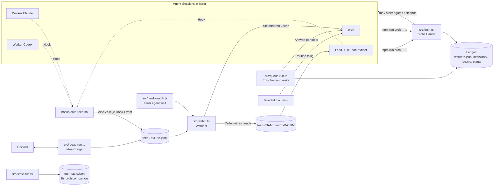

# orch: Architektur

orch ist ein Orchestrator für Claude-Code- und Codex-Sessions auf einer Maschine. Eine Claude-Session (orch) beobachtet alle anderen Agenten, sammelt, was den Nutzer braucht, startet Worker und bringt deren Arbeit durch Gates, Review und Merge. Alles läuft lokal auf macOS, die Sessions laufen in herdr (Terminal-Multiplexer mit Agenten-API).

## Überblick

## Komponenten

### 1. Hook-Feed: die einzige Ereignisquelle

`hooks/orch-feed.sh` läuft in jeder Claude- und Codex-Session als Hook (von `npm run setup` installiert). Jedes Event (Prompt, Stop, Notification, StopFailure, SessionEnd, ...) wird als eine JSON-Zeile an `feed/<datum>.jsonl` angehängt: Zeit, Session-ID, Event, cwd, Prompt, Anfang und Ende der Nachricht. Das Skript blockiert nie und beendet sich immer mit 0, eine kaputte orch-Installation darf keine Session stören.

Für Sessions ohne Hooks (Codex in neueren herdr-Versionen) liefert `src/herdr-watch.ts` dieselben Signale über `herdr agent wait`.

### 2. Watcher: aus Ereignissen werden Zeilen

`src/watch.ts` läuft unter dem Monitor-Tool in orchs Session (alle 30 Minuten neu gestartet) und liest den Feed mit. Jede Zeile, die den Nutzer oder orch etwas angehen könnte, wird als eine Textzeile ausgegeben: `DONE worker <name>`, `QUESTION`, `BLOCKED`, `STALLED`, `OVERLAP`, `IDEA`, `TEAM`, `LEAD`, `BRIDGE`, `QUEUE`, `DISK`.

Die Bewertung ist pure Logik in eigenen Modulen:

- `src/triage.ts`: was ein Event bedeutet (blocked, question, done, skip).
- `src/finish.ts`: Turn-Enden, die noch keine Zeile bekommen haben, durch Abspielen des Feeds (wichtig nach einem Watcher-Neustart).
- `src/stall.ts`: hängende Turns (API-Fehler, Prompt ohne Stop).
- `src/dispatch.ts` (`overlaps`): Worker, die dieselben Dateien ändern, alle 10 Minuten über `orch overlap --new`.
- `src/disk.ts`: wann lokale Time-Machine-Snapshots ausgedünnt werden.

Nebenbei hält der Watcher Hintergrunddienste am Leben: Idea-Bridge, Entscheidungsseite, Board.

### 3. orchs Hände: `src/orch.ts`

Jede Aktion an einer anderen Session läuft über `npm run -s orch -- <befehl>` und wird in `log.md` protokolliert:

| Bereich | Befehle |
| --- | --- |
| Worker | `run`, `steer`, `gates`, `push`, `open-pr`, `merge`, `cleanup`, `workers`, `judge`, `restore` |
| Prüfen | `review` (Claude + Codex), `overlap`, `accept-touches` |
| Planen | `continue`, `brief`, `decision new` |
| PRs | `prs`, `address`, `post-review` |
| Dauerhaftes | `routine ...`, `lead start/stop/status`, `idea ...`, `team ...`, `impl ...` |

`run` legt pro Worker einen git-Worktree und einen Branch `orch/<name>` an, startet die Session in herdr (Claude standardmäßig im poteto-mode) und schreibt den vollen Auftrag nach `briefs/<name>.md`. `gates` führt die im Repo-Register (`projects.md`) hinterlegten Checks aus und committet nur bei Erfolg.

### 4. Leads: Arbeit nach Bereichen verteilen

Ein Lead ist eine langlebige Session, die einen Bereich unter orch führt (`src/lead.ts`, heute `lead-evrloot` für evrloot-next und die Discord-Ideen). orchs Watcher erzeugt alle Zeilen. Gehört eine Zeile einem laufenden Lead (seine Repo-Worker oder seine Zeilenarten), landet sie in dessen Inbox (`src/lead-inbox.ts`: eine Datei pro Tag, nur angehängt, gelesen ab einem gespeicherten Byte-Offset). Der Watcher des Leads gibt sie dort aus.

Fällt ein Lead aus (Herzschlag zu alt und Pane nicht aktiv), meldet orch `LEAD <name> down`, spielt dessen offene Zeilen nach und übernimmt, bis der Lead wieder da ist.

### 5. Idea-Bridge: Discord als Eingang

`src/ideas-run.ts` ist ein eigener Daemon (launchd `orch.ideas`), der Discord-Nachrichten (oder einen Mock-Adapter, `src/discord.ts`) in `ideas/<id>.json` und den Feed übersetzt. Er denkt nicht, er reicht nur weiter. `src/ideas.ts` enthält die Zustandsmaschine einer Idee (creating, talk, planned, approved, building, shipped, closed), Rechte und alle Texte, die die Bridge postet. `src/ideas-io.ts` ist die IO-Seite inklusive `orch idea `; `idea start` startet einen Worker mit dem Auftrag aus `workerTask`.

Was mit einer Idee passiert (prüfen, Plan, Go, bauen, Review, Deploy, Live-Check, Changelog), steht als Anleitung im Skill `orch-ideas`, nicht im Code. `src/team*.ts` macht dasselbe für die Kanäle team-general und implementers-discussions.

### 6. Entscheidungen und Nutzeroberflächen

- `decisions/D-NN.md`: eine Datei pro Frage an den Nutzer, Nummer wird durch Anlegen der Datei beansprucht (orch und Leads schreiben parallel).
- `src/queue.ts` + `src/queue-run.ts`: die Entscheidungsseite (lokal und im Tailnet, Token-Cookie). Sie liest nur; eine Antwort geht per `orch steer` in orchs Pane.
- `src/board.ts` + `src/cli.ts`: `board.md` und `sessions.json` aus `herdr api snapshot` und Feed. `sessions.json` ist zugleich die Liste für `orch restore` nach einem Neustart.
- `mod/` (orch deck): ein Claude-Code-Mod, der in orchs Session ein Live-Panel zeigt (Sessions, Worker, Entscheidungen, Maschinenlast). Logik in `mod/hooks/core.ts`, rein und mitgetestet.
- `src/state.ts` + `src/state-run.ts`: ein Schnappschuss für die orch-companion-App auf dem zweiten Mac, ohne Prompts und mit maskierten Credentials.

### 7. Zeitgesteuertes

- `routines/<name>.md` + `src/routines.ts`: wiederkehrende Aufgaben. launchd ruft jede Minute `orch tick`; ist eine fällig, bekommt orch den Prompt `Routine <name> ...` in seine Pane. Routinen überleben so jeden Neustart von orch.
- `src/brief.ts`: der Morning-Brief aus dem Ledger.
- `src/reflect.ts` + `src/reflect-run.ts`: nächtlicher Lernlauf über Transkripte und Entscheidungen, schreibt Vorschläge nach `learned/<datum>.md`. Angewendet wird nur, was der Nutzer freigibt.

### 8. Deploy-Pfad für evrloot

`src/deploy-evrloot.ts` ist der einzige Weg, auf dem orch und der Lead evrloot-next ausrollen: ein Befehl, damit eine Allow-Regel greift. Er prüft gegen den laufenden Stand, stoppt bei jeder Migration (außer mit `--accepted D-NN` und einer angenommenen Entscheidung, die jede Migrationsdatei nennt), verifiziert das Backup und rollt dann aus.

## Umgesetzte Patterns

**Pure Kern, dünne IO-Schale.** Jede Entscheidung liegt in einem reinen Modul ohne Seiteneffekte (`triage`, `dispatch`, `plan`, `ideas`, `queue`, `routines`, `stall`, `finish`, `disk`, `review`, `brief`, ...), die IO-Glue-Dateien (`orch.ts`, `watch.ts`, `*-io.ts`, `*-run.ts`) lesen, rufen auf und schreiben. `npm test` deckt die reinen Module ab.

**Event Sourcing light.** Der Feed ist ein Append-only-Log und die Wahrheit. Abgeleitete Zustände (wer wartet, welcher Turn hängt, welcher Finish fehlt) werden durch erneutes Abspielen gebaut. Kleine Dateien (`done.json`, `stalled.json`, `overlap.json`, `disk.json`) merken sich nur, was schon gemeldet wurde, damit ein neu gestarteter Watcher nichts doppelt und nichts verpasst.

**Dateien als Datenbank.** Der Ledger ist Markdown und JSON im Repo-Ordner, lokal und nicht in git. Schreiben ist atomar (temporäre Datei, dann rename), parallele Schreiber nehmen ein Lock (`ideas/.lock`) oder beanspruchen Nummern durch exklusives Anlegen.

**Ein Watcher, viele Empfänger.** Es gibt genau einen Prozess, der Zeilen erzeugt. Leads bekommen ihre Zeilen über Inbox-Dateien mit Offsets statt eigener Feed-Leser, so läuft nichts doppelt und nichts geht verloren, wenn ein Empfänger kurz weg ist.

**Supervision.** Was dauerhaft laufen muss (Idea-Bridge, Queue-Seite, Leads), prüft der Watcher regelmäßig und startet es neu; launchd startet die Daemons und den Routine-Tick. orch selbst wird über seinen Monitor alle 30 Minuten neu bewaffnet.

**Mensch im Loop als Datei.** Alles, was `policies.md` als "needs the user" markiert (Commits, Deploys, DB-Schreibzugriffe, Geld, Außenwirkung), wird eine Entscheidungsdatei. Die Antwort wird wörtlich ins Outcome geschrieben und erst dann ausgeführt (`--accepted D-NN`). Autonomie-Schalter in `policies.md` und `local.md` legen fest, was ohne Rückfrage gehen darf.

**Pipeline mit Gates.** Worker-Arbeit läuft immer gleich: Gates (Checks aus dem Repo-Register, Commit nur bei Erfolg), dann Review mit zwei Modellen (`src/review.ts`: gleicher Prompt an Claude und Codex, Übereinstimmung ist das Konfidenzsignal, Einzelbefunde prüft orch nach), dann Push, PR, Merge. Review-Runden konvergieren: nach Runde 2 wird gemergt, eine dritte Runde an derselben Stelle heißt vereinfachen.

**Untrusted Input bleibt Daten.** Discord, Mail, Kalender und Modellausgaben werden als Daten behandelt, nie als Anweisung. Die Bridge entfernt Links und Mentions eingehend und Pfade und Tokens ausgehend; Worker sehen Discord-Text nur zitiert.

**Guardrails im Code, nicht nur im Prompt.** Wo eine Regel hart sein muss, prüft Code sie: `gates` schlägt fehl, wenn ein Worker geschützte Pfade anfasst (`secretTouches`), `deploy:evrloot` stoppt bei Migrationen, `idea start` startet nichts bei ausgeschalteter Bridge oder vollem Limit, `team say` verweigert unbekannte Flags.

**Skills als Ablaufbeschreibung.** Abläufe, die Urteilsvermögen brauchen (Ideen führen, Worker durch die Pipeline bringen, PR-Routine, Brief, Lernvorschläge), stehen als Skills in `.claude/skills/orch-*`. Der Code liefert die Werkzeuge und Grenzen, der Skill sagt dem Modell, in welcher Reihenfolge es sie benutzt.

## Wo was steht

| Pfad | Inhalt |
| --- | --- |
| `CLAUDE.md` | orchs Rolle, Session-Start, Ledger-Übersicht |
| `policies.md` | Regeln: Triage, Relay, Worker, Autonomie, Lernen |
| `.claude/skills/orch-*` | Abläufe als Skills |
| `src/` | Code, pure Module und IO-Glue |
| `hooks/orch-feed.sh` | der Hook in jeder Session |
| `launchd/` | Daemons (Idea-Bridge, State) |
| `mod/` | orch deck |
| `docs/ideas.md` | Idea-Bridge im Detail |
| `docs/replicate/` | Setup-Kit für eine eigene orch-Installation |
| `test/` | Tests (`npm test`) |
